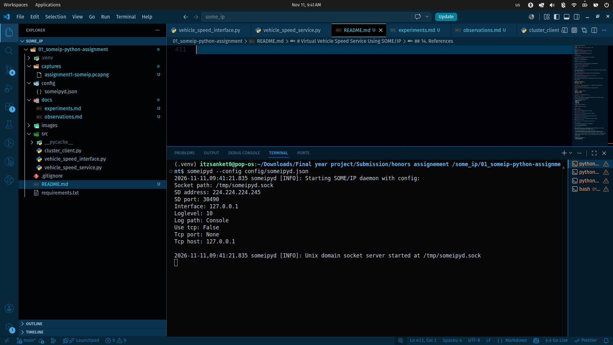
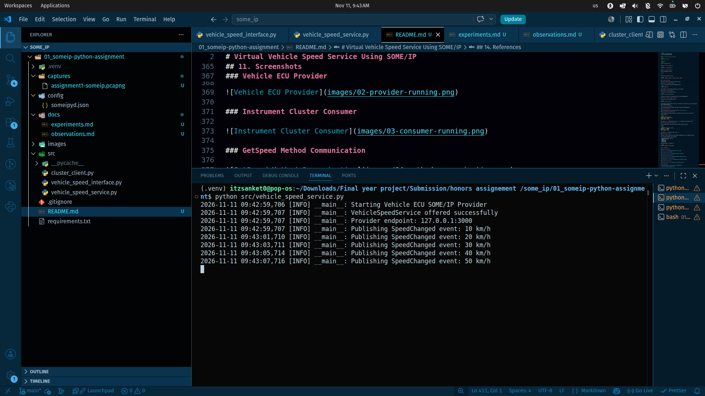
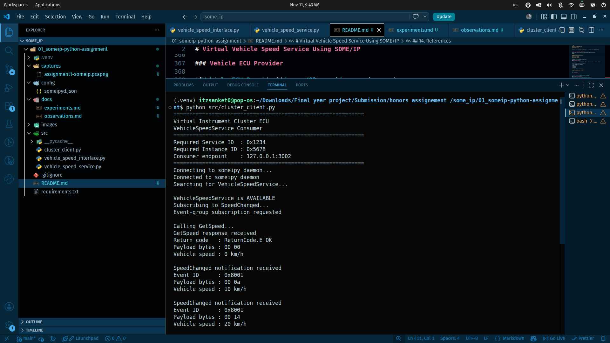
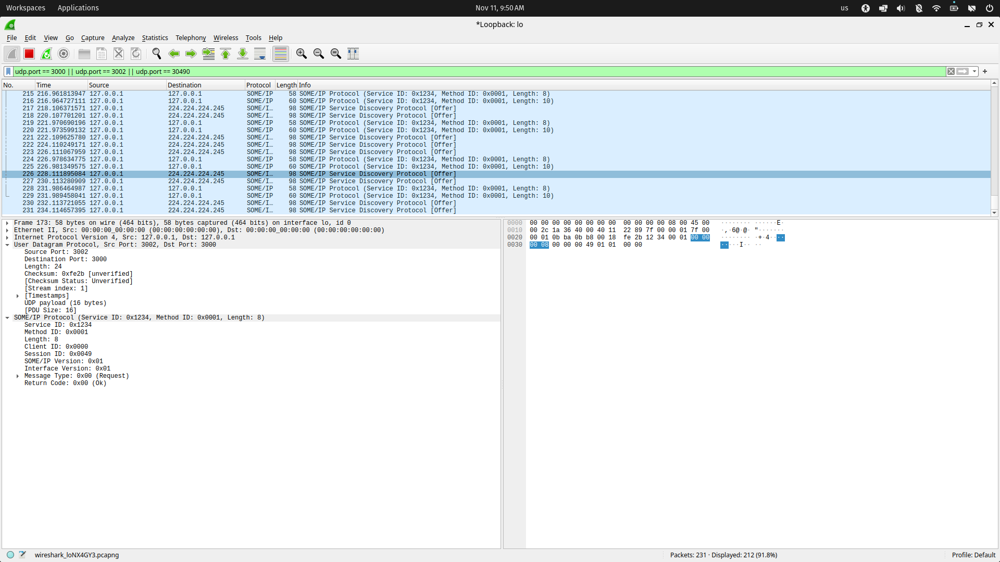

# Virtual Vehicle Speed Service Using SOME/IP

## 1. Project Overview

This project demonstrates the implementation of a virtual vehicle speed service using **SOME/IP (Scalable Service-Oriented Middleware over IP)** with Python and the `someipy` library.

The project simulates communication between two virtual Electronic Control Units (ECUs) running on the same Linux machine:

- **Vehicle ECU:** Acts as the SOME/IP service provider.
- **Instrument Cluster ECU:** Acts as the SOME/IP service consumer.

The Vehicle ECU provides vehicle speed information through a SOME/IP service called `VehicleSpeedService`.

The Instrument Cluster ECU communicates with the Vehicle ECU using two communication mechanisms:

1. **Method Communication:** Requests the current vehicle speed using `GetSpeed`.
2. **Event Communication:** Receives periodic speed updates through `SpeedChanged`.

Service Discovery is used to discover the service and establish communication between the two ECUs.

## 2. Objectives

- Understand the fundamentals of SOME/IP communication.
- Implement a SOME/IP service provider using Python.
- Implement a SOME/IP service consumer using Python.
- Understand request-response communication.
- Understand publish-subscribe event communication.
- Implement SOME/IP Service Discovery.
- Capture and inspect SOME/IP packets using Wireshark.

## 3. System Architecture

The project consists of three main runtime components:

1. SOME/IP Daemon
2. Vehicle ECU (Service Provider)
3. Instrument Cluster ECU (Service Consumer)

### Communication Architecture

```text
                 SOME/IP Communication
                         
        +--------------------------------+
        |        SOME/IP Daemon          |
        |                                |
        |       Service Discovery        |
        +--------------------------------+
                  |           |
                  |           |
        +---------+           +---------+
        |                               |
+----------------------+      +----------------------+
|     Vehicle ECU      |      | Instrument Cluster   |
|                      |      |       ECU            |
|  Service Provider    |      |   Service Consumer   |
|                      |      |                      |
| VehicleSpeedService  |      |   GetSpeed()         |
|                      |      |                      |
| GetSpeed Method      |<---->|   Request/Response   |
|                      |      |                      |
| SpeedChanged Event   |----->|   Event Subscription |
+----------------------+      +----------------------+
```

### Communication Flow

**Method Communication:**

The Instrument Cluster sends a `GetSpeed` request to the Vehicle ECU. The Vehicle ECU processes the request and returns the current vehicle speed.

**Event Communication:**

The Instrument Cluster subscribes to the `SpeedChanged` event. The Vehicle ECU periodically publishes speed updates, which are received by the Instrument Cluster.

## 4. Technology Stack

| Component | Technology |
|---|---|
| Programming Language | Python |
| SOME/IP Library | someipy |
| Communication Protocol | SOME/IP |
| Transport Protocol | UDP |
| Service Discovery | SOME/IP-SD |
| Packet Analysis | Wireshark |
| Operating System | Pop!_OS / Linux |
| Development Environment | Visual Studio Code |

## 5. SOME/IP Service Interface

The project implements the following service interface.

### Service Configuration

| Parameter | Value |
|---|---|
| Service Name | VehicleSpeedService |
| Service ID | `0x1234` |
| Instance ID | `0x5678` |
| Major Version | `1` |
| Transport Protocol | UDP |
| Provider IP | `127.0.0.1` |
| Provider Port | `3000` |
| Consumer IP | `127.0.0.1` |
| Consumer Port | `3002` |

### Method Definition

| Parameter | Value |
|---|---|
| Method Name | GetSpeed |
| Method ID | `0x0001` |
| Communication Type | Request-Response |
| Request Payload | Empty |
| Response Payload | Unsigned 16-bit speed value |
| Unit | km/h |

### Event Definition

| Parameter | Value |
|---|---|
| Event Name | SpeedChanged |
| Event ID | `0x8001` |
| Event Group ID | `0x0001` |
| Communication Type | Publish-Subscribe |
| Payload | Unsigned 16-bit speed value |
| Publishing Interval | 2 seconds |

### Service Discovery Configuration

| Parameter | Value |
|---|---|
| SD Multicast Address | `224.224.224.245` |
| SD Port | `30490` |

## 6. Project Structure

```text
01_someip-python-assignment/
│
├── src/
│   ├── vehicle_speed_interface.py
│   ├── vehicle_speed_service.py
│   └── cluster_client.py
│
├── config/
│   └── someipyd.json
│
├── captures/
│   └── assignment1-someip.pcapng
│
├── docs/
│   ├── experiments.md
│   └── observations.md
│
├── images/
│   ├── 01-environment-setup.png
│   ├── 02-provider-running.png
│   ├── 03-consumer-running.png
│   ├── 04-method-communication.png
│   ├── 05-event-communication.png
│   └── 06-wireshark-analysis.png
│
├── .gitignore
├── requirements.txt
└── README.md
```

## 7. Implementation Details

### 7.1 Common SOME/IP Interface

File: `src/vehicle_speed_interface.py`

This module contains the common service definitions and configuration shared between the provider and consumer.

It defines:

- Service ID and Instance ID.
- Service version.
- Method ID.
- Event ID.
- Event Group ID.
- Network configuration.
- Speed payload serialization and deserialization.

### 7.2 Vehicle ECU - Service Provider

File: `src/vehicle_speed_service.py`

The Vehicle ECU implements the `VehicleSpeedService`.

Its responsibilities include:

- Connecting to the SOME/IP daemon.
- Creating the service instance.
- Offering the service through SOME/IP Service Discovery.
- Handling incoming `GetSpeed` requests.
- Returning the current speed as a two-byte payload.
- Simulating vehicle speed changes.
- Publishing periodic `SpeedChanged` events.

### 7.3 Instrument Cluster ECU - Service Consumer

File: `src/cluster_client.py`

The Instrument Cluster ECU consumes the VehicleSpeedService.

Its responsibilities include:

- Connecting to the SOME/IP daemon.
- Discovering the VehicleSpeedService.
- Subscribing to the `SpeedChanged` event group.
- Sending `GetSpeed` method requests.
- Receiving and decoding method responses.
- Receiving and decoding periodic event notifications.

### 7.4 SOME/IP Daemon Configuration

File: `config/someipyd.json`

The daemon configuration specifies the Service Discovery multicast address, port, logging level, and network interface.

## 8. Installation and Setup

### Prerequisites

- Python 3
- Linux operating system
- Visual Studio Code
- Wireshark
- Internet connection for installing dependencies

### Step 1: Clone the Repository

```bash
git clone <YOUR_REPOSITORY_URL>
cd 01_someip-python-assignment
```

### Step 2: Create a Virtual Environment

```bash
python3 -m venv .venv
```

Activate it:

```bash
source .venv/bin/activate
```

### Step 3: Install Dependencies

```bash
pip install -r requirements.txt
```

### Step 4: Configure Wireshark

Select the loopback interface:

```text
lo
```

Use the following display filter:

```text
udp.port == 30490 || udp.port == 3000 || udp.port == 3002
```

## 9. Running the Project

The project requires three separate terminal sessions.

### Terminal 1: Start SOME/IP Daemon

Start the someipy daemon using the configuration file:

```text
config/someipyd.json
```

Use the daemon startup command configured in your environment.

### Terminal 2: Start Vehicle ECU

Activate the virtual environment and run:

```bash
python src/vehicle_speed_service.py
```

The Vehicle ECU connects to the daemon and offers the VehicleSpeedService.

### Terminal 3: Start Instrument Cluster ECU

Activate the virtual environment and run:

```bash
python src/cluster_client.py
```

The Instrument Cluster discovers the service, subscribes to the event group, and starts requesting vehicle speed information.

## 10. Verification and Results

The following communication scenarios have been verified during implementation.

### 10.1 Service Discovery

The Instrument Cluster successfully discovers the `VehicleSpeedService`.

### 10.2 GetSpeed Method Communication

The Instrument Cluster sends a request to the Vehicle ECU and receives the current speed.

Example response:

```text
GetSpeed response received
Return code   : ReturnCode.E_OK
Payload bytes : 00 0a
Vehicle speed : 10 km/h
```

The payload `00 0a` represents decimal value `10` in unsigned 16-bit big-endian format.

### 10.3 SpeedChanged Event Communication

The Instrument Cluster successfully receives periodic speed notifications.

Example:

```text
SpeedChanged notification received
Event ID      : 0x8001
Payload bytes : 00 14
Vehicle speed : 20 km/h
```

The payload `00 14` represents decimal value `20`.

### 10.4 Wireshark Analysis

Wireshark is used to capture and inspect SOME/IP communication over the loopback interface.

The following information can be inspected:

- Source and destination UDP ports.
- SOME/IP Service ID.
- Method ID.
- Message Type.
- Return Code.
- Payload data.

The packet capture is available in:

```text
captures/assignment1-someip.pcapng
```
## 11. Screenshots

### SOME/IP Daemon



### Vehicle ECU Provider



### Instrument Cluster Consumer



### GetSpeed Method Request



### GetSpeed Method Response


### SpeedChanged Event Communication


### Wireshark Packet Analysis


## 12. Experiments

The experiment details and observations are documented in:

- [Experiments](docs/experiments.md)
- [Observations](docs/observations.md)

## 13. Conclusion

This mini-project demonstrates the implementation of a basic SOME/IP-based service-oriented communication system using Python and the someipy library.

Two virtual ECUs communicate over UDP on the same Linux machine.

The implementation demonstrates service discovery, request-response communication using the `GetSpeed` method, and publish-subscribe communication using the `SpeedChanged` event.

Wireshark is used to inspect the network traffic and understand the structure of SOME/IP messages.

The project provides practical exposure to service-oriented communication used in automotive software systems.

## 14. References

- SOME/IP Protocol Documentation
- someipy Python Library
- Wireshark Documentation
